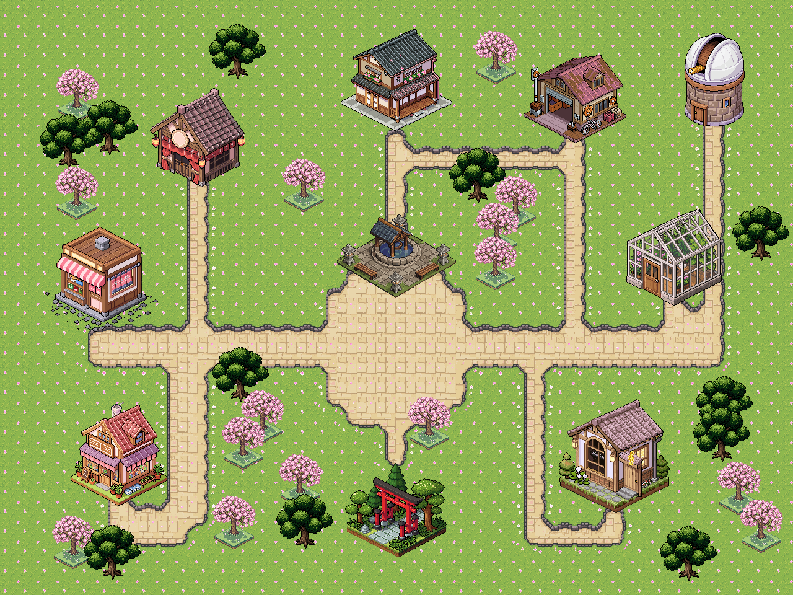

  

  
  
  

## 👋 Prazer, Lucas

Sou **advogado previdenciarista** e, nas horas vagas, **"metido a dev"**. Comecei a programar para resolver problemas do meu próprio escritório e acabei publicando as ferramentas para quem também quiser usar.

- ⚖️ **No dia a dia:** aposentadorias, BPC/LOAS, incapacidade, pensão por morte, revisões e recursos no INSS e no JEF.
- 🧠 **No código:** skills e plugins de IA que leem o processo, montam a tabela de provas e apontam riscos — **sempre com a fonte de cada informação** à vista.
- 🔒 **Regra de ouro:** dado de cliente não entra aqui. As ferramentas ajudam; quem decide e assina é o advogado.
- 🚗 **Por diversão:** estou transformando a central do meu **Subaru Impreza 1993** num computador com assistente de voz.

## 🎓 Formação

| | |
| --- | --- |
| ⚖️ **Direito** | Advogado · **Pós-graduado em Direito Previdenciário** |
| 💻 **Computação** | Cursei **Ciência da Computação** na **UNEMAT** — campus Rondonópolis (MT) |
| 🤖 **Inteligência Artificial** | **Alura** — formações em andamento em **Python**, **PyTorch** e **Engenharia de IA** |

## 🌸 Sou o autor da [Harumi Life](https://www.harumilife.com)

<table>
  <tr>
    <td width="45%" valign="top">
      
    </td>
    <td width="55%" valign="top">
      
      <b><a href="https://www.harumilife.com">www.harumilife.com</a></b> é a casa da <b>Harumi</b>, uma personagem de IA que <b>vive 24 horas por dia</b> num mundo em pixel art: ela lê, programa, cuida das plantas, dorme, sonha e escreve um diário.
        
      Quem visita o site acompanha a casa <b>ao vivo</b>, conversa com ela e pode mandar presentes.
        
      🧪 É o meu <b>laboratório de estudo de micro modelos de IA</b>: tudo roda num <b>Orange Pi</b> aqui em casa, com modelos pequenos e locais.
        
      🔒 O código é <b>privado</b>; o site é aberto para todo mundo.
        
      
        
        
    </td>
  </tr>
</table>

  

## ⚖️ Ferramentas para a advocacia

<table>
  <tr>
    <td width="50%" valign="top">
      
      <h3>🗂️ <a href="https://github.com/Barkoski/dossie">Dossiê</a></h3>
      Transforma a análise do caso em dossiê conferível: <b>tabela de provas, requisitos, cronologia, grafo e relatório</b>, com painel HTML que abre offline.
        
        
    </td>
    <td width="50%" valign="top">
      
      <h3>⚖️ <a href="https://github.com/Barkoski/advocacia-previdenciaria-barkoski">Advocacia Previdenciária</a></h3>
      Análise e redação previdenciária com <b>fontes, tabela de provas e tese adversa</b>. Revisão humana em cada entrega.
        
        
    </td>
  </tr>
  <tr>
    <td width="50%" valign="top">
      
      <h3>🧾 <a href="https://github.com/Barkoski/advocacia-previdenciaria-barkoski-codex">Previdenciário no Codex</a></h3>
      A mesma análise documental, com <b>matriz requisito-prova-risco</b> e revisão adversarial de minutas, para quem usa o Codex.
        
       
    </td>
    <td width="50%" valign="top">
      
      <h3>🛡️ <a href="https://github.com/Barkoski/barkoski-auditoria-lgpd">Auditoria LGPD</a></h3>
      Audita apps e sites pela LGPD: <b>fluxos de dados, código e governança</b>, com evidências, riscos e plano de ação.
        
       
    </td>
  </tr>
</table>

## 🧰 Ferramentas de IA

<table>
  <tr>
    <td width="50%" valign="top">
      
      <h3>🧠 <a href="https://github.com/Barkoski/consultor-primeiro">Consultor primeiro</a></h3>
      Primeiro pensar, depois fazer, por fim conferir: <b>um consultor define a estratégia</b>, agentes executam e o principal revisa.
        
       
    </td>
    <td width="50%" valign="top">
      
      <h3>🌉 <a href="https://github.com/Barkoski/ponte-ia">Ponte IA</a></h3>
      <b>Claude e ChatGPT na mesma conversa</b>: respostas lado a lado, debate, crítica cruzada e síntese. App para Windows.
        
        
    </td>
  </tr>
</table>

## 🚗 Projeto pessoal

<table>
  <tr>
    <td width="50%" valign="top">
      
    </td>
    <td width="50%" valign="top">
      <h3>🌸 <a href="https://github.com/Barkoski/harumi-auto-os">Harumi Auto OS</a></h3>
      A central multimídia do meu <b>Subaru Impreza 1993</b>, com a assistente <b>Harumi</b>: mapas, música, painel do carro e conversa por voz — com a <b>IA rodando no próprio carro</b>, sem internet.
        
         
    </td>
  </tr>
</table>

## 🛠️ Com o que eu trabalho

  
  
  
  
   
  
  
  
  
  

---

  ⚖️ Ferramentas de apoio: nenhuma substitui o advogado. &nbsp;·&nbsp; 🔒 Nada de dado de cliente por aqui. &nbsp;·&nbsp; ⭐ Se algum projeto te ajudou, deixa uma estrela!

